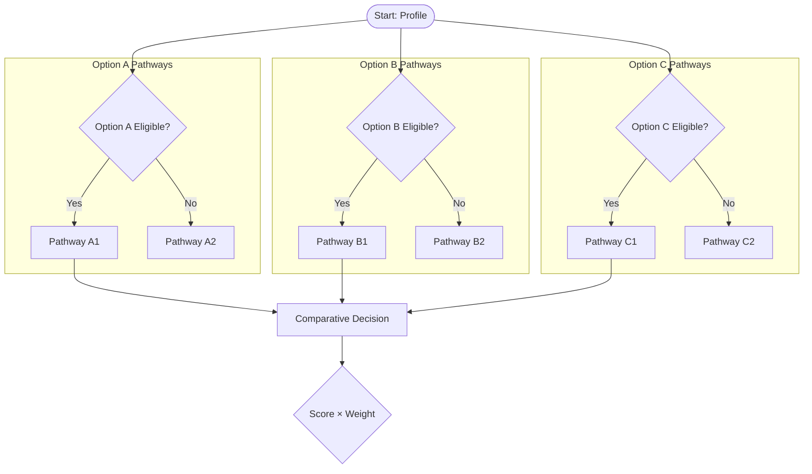
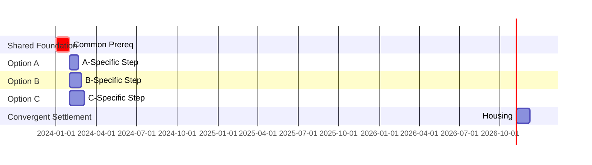
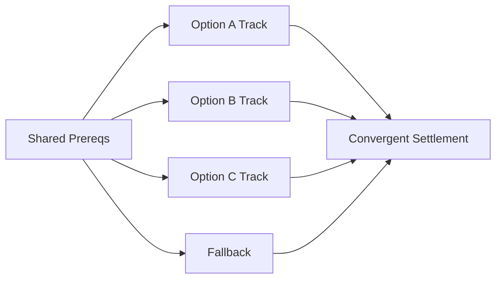

# Comparative Analysis Pattern — Reference

Used when the investigation is a comparative decision analysis between two or more distinct systems, countries, or options (e.g., Country A vs Country B vs Country C, Platform X vs Platform Y, Pathway 1 vs Pathway 2). This pattern extends the standard surgical-investigation procedure for comparative outputs.

---

## Scope Definition Additions (Step 1)

For comparative analyses, the scope template includes:

```
## Investigation Scope — Comparative

Options:         [Option A, Option B, Option C, Fallback D, ...]
Profile:         [Applicant profile: citizenship, qualifications, family, urgency, budget]
Decision Weights: [Speed to status, Cost, Certainty, QoL, Citizenship timeline, Safety, Tax]
Output:          [HTML report with tabbed comparison + unified decision tree]
Strategy:        [full-sweep with comparative decomposition]
```

---

## Subagent Decomposition (Step 7)

### For 2 Options (A vs B)
Use the Comparative Analysis Decomposition from search-strategy-system.md:
- 1A/1B: Official requirements per option (parallel)
- 2A/2B: Policy changes per option (parallel)
- 3: Community intelligence for both (shared)
- 4: Alternative & fallback options (shared)
- 5: Practical logistics for both (shared)
- 6: Risk & cross-border (shared)

### For 3+ Options (Multi-Country/Multi-Pathway)
Group options into 2-3 subagents by domain overlap:
- Subagent 1: Country/Option Group A official requirements
- Subagent 2: Country/Option Group B official requirements
- Subagent 3: Community intelligence (all options, shared sources)
- Subagent 4: Practical logistics (all options, cost/housing/tax comparison)
- Subagent 5: Risk & cross-border (all options, shared SA pipeline)
- Subagent 6: Alternative/fallback pathways (shared)

Shared foundation (documents, profile, SA admin) researched once.
Option-specific tracks in parallel.
Convergent settlement (housing, banking, tax) researched once.

---

## HTML Report Structure (Step 8a)

### Tabbed Comparison Tables
Implement tabbed interface in HTML report for side-by-side pathway comparison:
- Tab 1: Option A pathways table
- Tab 2: Option B pathways table
- Tab 3: Option C pathways table
- ... (one tab per option)
- Tab N: Fallback options table
- Tab N+1: Side-by-side quantitative comparison (salary, cost, QoL, timeline)

### Unified Decision Tree (backend-architecture.mmd)
Single decision tree with subgraphs per option:


### Parallel Timeline (frontend-architecture.mmd)
Gantt chart with shared foundation section, option-specific sections, convergent settlement section:


### Combined Risk Matrix (research-findings.mmd)
Single quadrant chart with colour-coded prefixes:
- "Option A: Risk description" [likelihood, impact]
- "Option B: Risk description" [likelihood, impact]
- "Option C: Risk description" [likelihood, impact]
- "Shared: Risk description" [likelihood, impact]

### Dependency Graph (entire-project.mmd)
Shared prerequisites → divergent option tracks → convergent settlement:


---

## Recommendation Format (Step 8a, Section 7)

For comparative analyses, recommendations include:
- **Primary recommendation**: Which option to pursue, with weighted score rationale
- **Conditional branches**: "If X, then Option A; if Y, then Option B; if Z, then Option C"
- **Fallback triggers**: "If primary fails at milestone M, activate Option D"
- **Parallel tracks**: Run Option A + Option B + Option C simultaneously
- **Actionable next steps**: Owner, deadline, budget per track

---

## Mermaid Diagram Templates

See mermaid-best-practices.md for:
- Comparative Decision Tree template
- Parallel Timeline with Shared Foundation template
- Colour coding: Option A = green, Option B = blue, Option C = purple, Shared = grey, Fallback = orange, Critical = red

---

## Pitfalls

- **Don't duplicate shared research** — Profile, documents, SA admin pipeline researched once
- **Don't mix option-specific risks** in the matrix without clear prefixes
- **Don't omit fallback options** — always include 2-3 third countries/paths
- **Don't weight all dimensions equally** — elicit user weights or use profile-based defaults
- **Do surface source tier per option** — Tier 1 sources may differ per country
- **Do include cross-border tax in logistics** — Double tax treaties, exit tax, wealth tax implications
- **Do read_file before write_file** when overwriting existing report files — the write_file tool refuses with stale_write_blocked if the file wasn't freshly read in the current turn
- **Do verify tool effects after network interruptions** — check if files were written before retrying; empty responses may still have executed